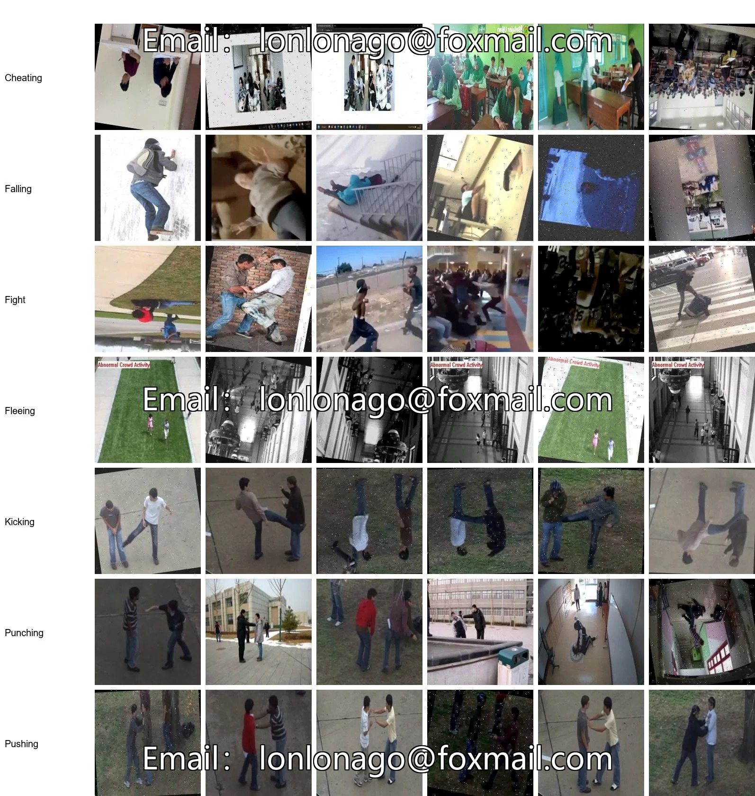
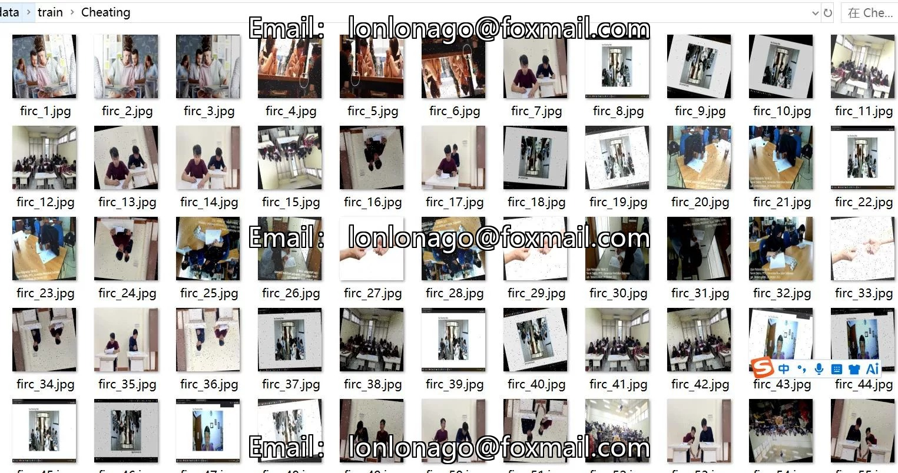
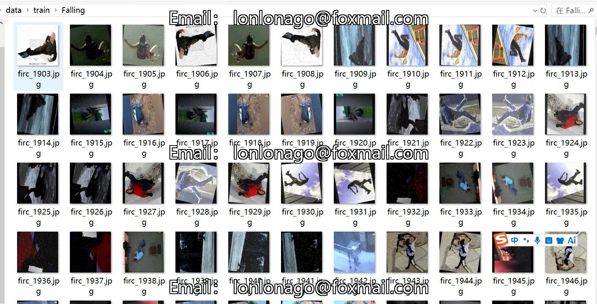
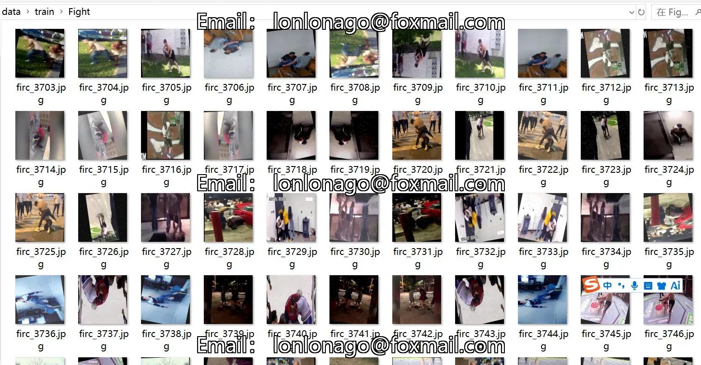

# Image Classification Dataset for Abnormal Behavior Identification: 13,965 images in 7 categories with enhancements

## Body

Exception Behavior Identification Image Classification Dataset: 13,965 images in 7 categories with enhancements
Tips: Due to the dataset's replicability, please confirm compliance before purchasing.
Note: Approximately 5,000 images in the dataset are original and the remaining are enhanced images. The main types of enhancements include rotation and noise addition. The resolution is 224x244 which is slightly low.
Dataset Type: For image classification use, not for object detection with unlabeled files.
Dataset Format: Only contains jpg images, each category folder contains corresponding images.
Number of Images (Total JPG Files): 13,965
Number of Categories: 7
Image Resolution: 224x224

Category Names: ['Cheating', 'Falling', 'Fight', 'Fleeing', 'Kicking', 'Punching', 'Pushing']
Number of Images per Category
Training Set Image Count: 12888
Training Set Image Count: 12888
- Cheating (Cheating) Training Set Image Count: 1902
- Falling (Falling) Training Set Image Count: 1800
- Fight (Fight) Training Set Image Count: 1836
- Fleeing (Fleeing) Training Set Image Count: 1887
- Kicking (Kicking) Training Set Image Count: 1803

- Punching (Boxing) training set image count: 1854
- Pushing training set image count: 1806
Number of validation set images: 539
- Cheating (Cheating) verification set image count: 62
- Falling (Fall) validation set image count: 91
- Fight (fight) verification set image count: 81
- Fleeing (Escaping) Validation Set Image Count: 61
- Kicking (kicking) validation set image count: 86
- Punching (boxing) validation set image count: 71
Pushing (push) verification set image count: 87
Number of test set images: 538

- Cheating (test set images): 69
- Falling (Fall) Test Set Image Count: 78
- Fight (fight) test set image count: 74
- Fleeing (Test set images count): 77
- Kicking (kicking) test set image count: 80
- Punching (boxing) test set image count: 79
Pushing (pushing) test set image count: 81
Total number of images
- Cheating (cheating) total picture count: 2033
- Falling (fall) total image count: 1969
- Fight (fighting) total image count: 1991

- Fleeing (Total images: 2025)
- Kicking (Total images: 1969)
- Punching (Total images: 2004)
- Pushing (Total images: 1974)
Important Note: No specifics provided.
Special Remark: This dataset does not guarantee the accuracy of the trained models or weight files.

## Images

## Payment

Here is a pay link on Stripe ( https://buy.stripe.com/3cs8yP7sY87d0vu9AB ). Please contact me lonlonago@foxmail.com after funding $89, and I will send you a complete data files , thank you!

